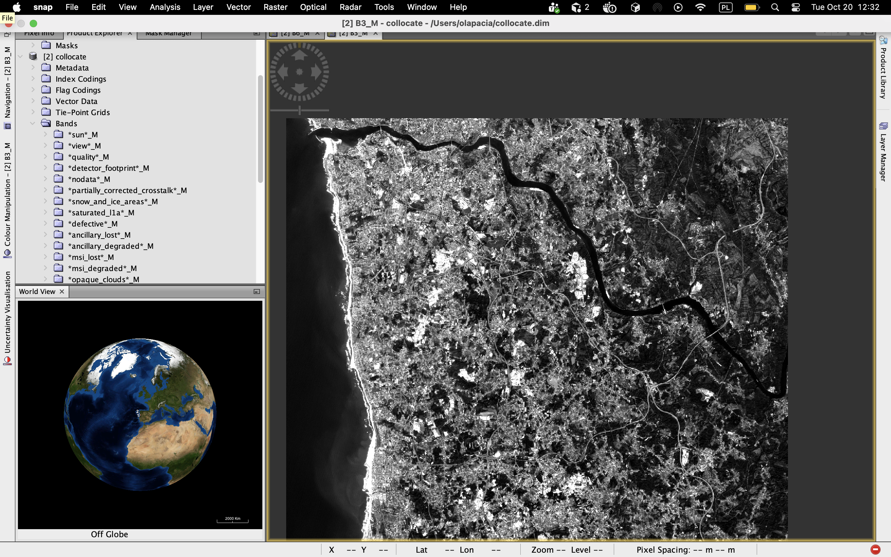
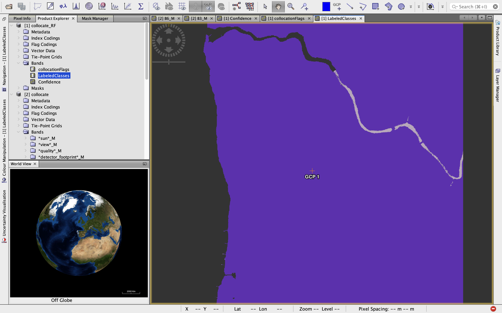
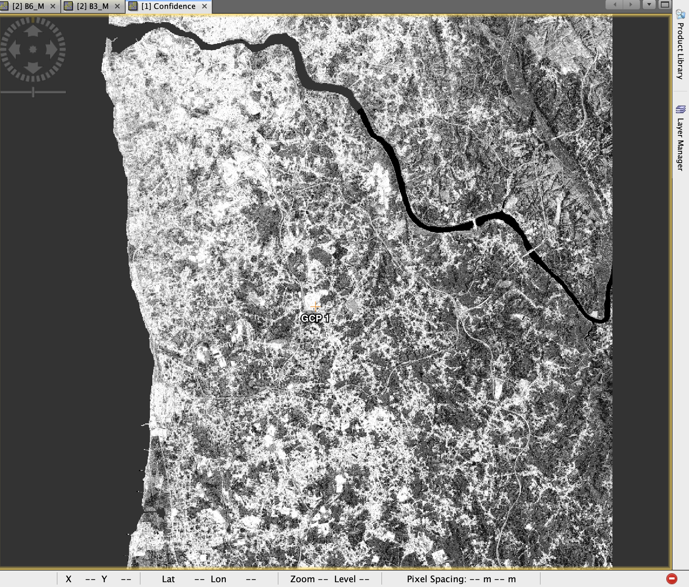
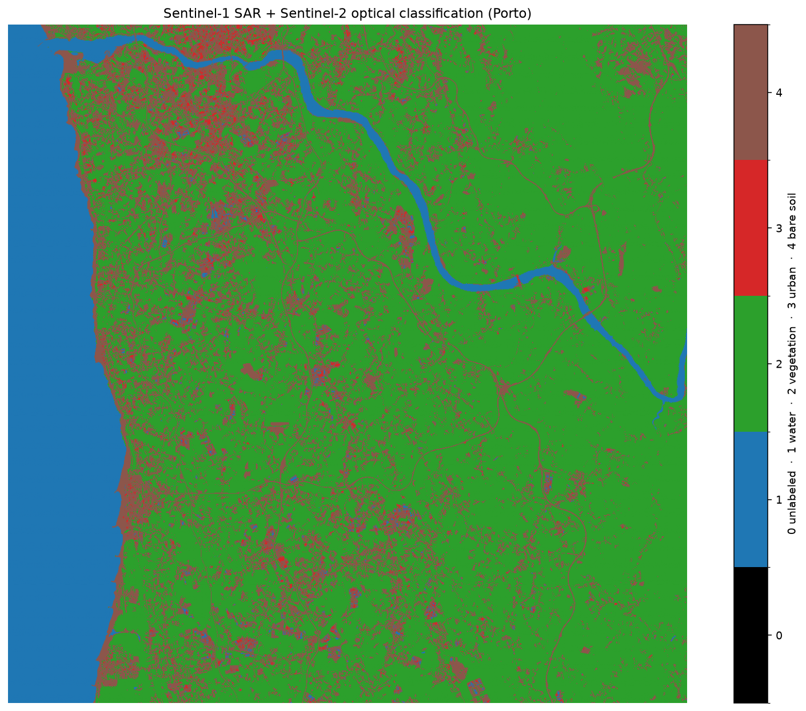
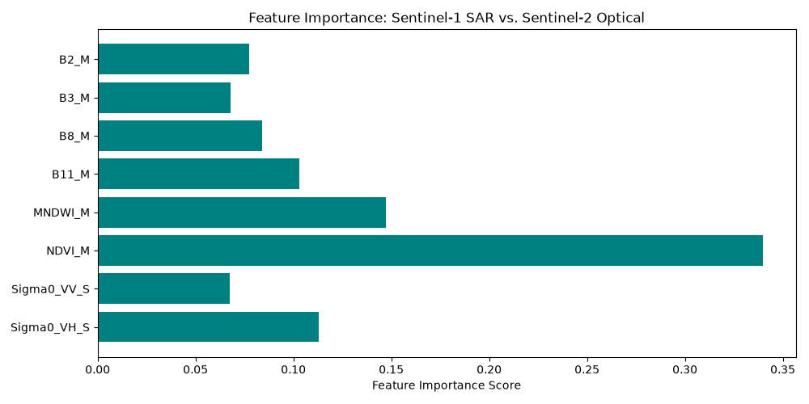
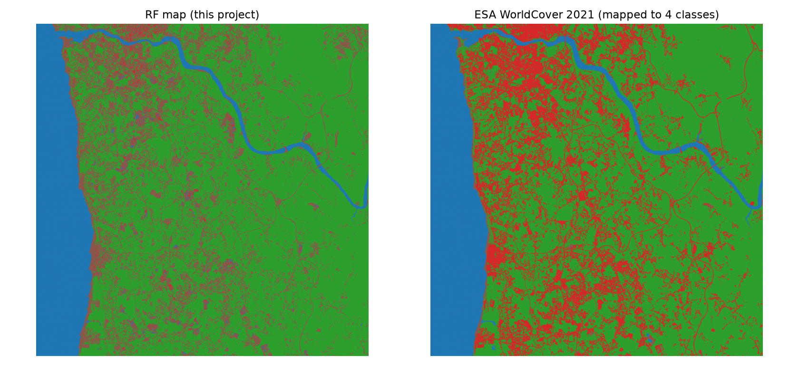
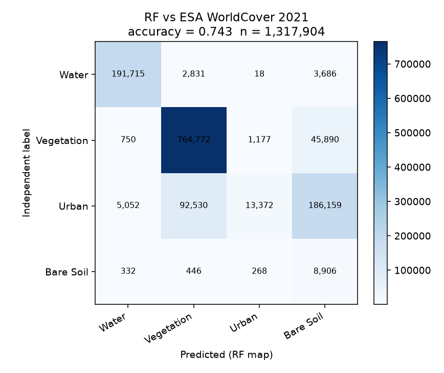

# Porto land-cover: Sentinel-1 + Sentinel-2 (SNAP + Python)

**Title:** Fusing Sentinel-1 SAR and Sentinel-2 optical data in SNAP for land-cover classification of Porto (Random Forest, spatial-block validation)

Erasmus project, Universidade do Porto (Geospatial Engineering). Home university: AGH Krakow.

https://github.com/aleksandrapacia/PortoProject

Class codes: **1 water · 2 vegetation · 3 urban · 4 bare soil · 0 unlabeled**.

---

## What we did

1. **Collocate** Sentinel-1 (σ⁰ VV, VH) with Sentinel-2 in SNAP, including MNDWI and NDVI.
2. **Classify** each pixel as water / vegetation / urban / bare soil.
   - First in SNAP (Random Forest + confidence layer).
   - Then in Python (`sklearn` Random Forest on raw bands B2, B3, B8, B11, VV, VH).
3. **See the leak:** labels taken from NDVI/MNDWI/SAR thresholds make a random-split score look like ~100%. That is not map accuracy.
4. **Spatial block CV** (`GroupKFold`) — still high, because labels are still from the same image.
5. **Independent test:** score the Python map against **ESA WorldCover 2021** (10 m, tile N39W009, remapped to the same 4 classes). Agreement ~74%; urban is the class that fails.

DEM and hand-drawn QGIS ROIs are the next step, not done yet.

---

## Folders

| Path | What |
|------|------|
| `code_Porto/code/` | Analysis scripts (`ml_Porto_analysis.py`, `independent_labels.py`) |
| `code_Porto/results/` | **All outputs** (maps, SNAP screenshots, GeoTIFFs) |
| `code_Porto/data/` | SNAP stacks (local, not on GitHub) |
| `code_Porto/labels/` | Optional QGIS polygons (`rois.geojson`) |
| `code_Porto/scratch/` | Practice numpy snippets, not part of the analysis |
| `docs/Porto_S1S2_classification_description.pdf` | Short project description PDF |
| `data/` | First S2 L2A subset from an earlier download (local) |
| `scripts/` | Helpers (PDF, download) |
| `requirements.txt` | Python packages |

```bash
cd code_Porto/code
python ml_Porto_analysis.py       # Python map → results/
python independent_labels.py      # WorldCover test → results/
```

---

## Data

Raw SAFE archives are not in git. Open SNAP products with **File → Open** → the `.dim` file.

**Classification stack** (what the Random Forest uses): `code_Porto/data/collocate.dim` / `collocate.tif`.

| File in `code_Porto/data/` | What it is |
|---------------------------|------------|
| `collocate.dim` + `collocate.data/` | SNAP-collocated Sentinel-1 (σ⁰ VV, VH) + Sentinel-2 |
| `collocate.tif` | GeoTIFF export of that stack |
| `s2_l2a_20261013_T29TNF_resampled.dim` + `.data/` | Sentinel-2 L2A, 13 Oct 2026, tile T29TNF, resampled in SNAP |
| `s2_l2a_20261013_T29TNF_working.dim` + `.data/` | Same scene, SNAP working copy (was `db11`) |

**First S2 product** (earlier download, `data/processed/`):

| Field | Value |
|-------|--------|
| File | `data/processed/S2C_MSIL2A_20251010T112131_R037_T29TNF_20251010T151313_douro.dim` |
| Format | BEAM-DIMAP (`.dim` + `.data/`) |
| Tile | T29TNF (Porto / Douro) |
| Date | 2025-10-10, ~11:21 UTC |
| Cloud cover | ~0% |
| AOI | 8.85°W–8.45°W, 41.05°N–41.22°N |
| Bands | B01–B08, B8A, B11, B12, SCL |
| Level | L2A subset |

GeoTIFF copy and STAC metadata: `data/raw/`.

**Independent test labels:** ESA WorldCover 2021, 10 m, tile N39W009. CORINE is 100 m — too coarse, not used.

---

## Independent labels (optional QGIS ROIs)

The Random Forest was trained on index thresholds. Those scores cannot be trusted. External labels are used only to **test** the map.

| Source | Resolution | Role |
|--------|------------|------|
| ESA WorldCover 2021 | 10 m | automatic wall-to-wall reference (done) |
| QGIS / SNAP ROIs | polygons you draw | few trusted pixels in `code_Porto/labels/rois.geojson` |
| CORINE | 100 m | not used |
| DEM | — | later |

To add hand ROIs:

1. Open `code_Porto/results/map_python_random_forest.tif` in QGIS.
2. New layer, EPSG:4326, integer field `class` (1–4).
3. Draw small polygons inside homogeneous areas. Avoid edges.
4. Save as `code_Porto/labels/rois.geojson`.
5. Rerun `python independent_labels.py`.

---

## Outputs

Everything is in `code_Porto/results/`. Numbered PNGs follow the workflow. GeoTIFFs are for QGIS.

### What changed in the tidy-up

Figures used to have duplicate copies and typo names (`classifciation.png`, `condfidence.png`, `Figure_1.png`, `class_1_2.png`, `python_classification.png`). Now there is **one file per result**:

| Old name | Now |
|----------|-----|
| `RADAR+SPEC.png` | `01_snap_collocate_green_band.png` |
| `classifciation.png` | `02_snap_rf_labeled_classes.png` |
| `condfidence.png` | `03_snap_rf_confidence.png` |
| `fig_classification.png` (and duplicates) | `04_python_landcover_map.png` |
| `fig_importance.png` / `Figure_1.png` | `05_python_feature_importance.png` |
| `fig_rf_vs_worldcover.png` | `06_python_rf_vs_worldcover.png` |
| `fig_cm_worldcover.png` | `07_python_rf_vs_worldcover_confusion.png` |
| `classified_porto_python.tif` | `map_python_random_forest.tif` |
| `worldcover_4class.tif` | `map_worldcover_4class.tif` |

SNAP products that sat at the repo root (`db11.dim`, the 13 Oct 2026 S2 scene) moved into `code_Porto/data/`. Practice scripts moved to `code_Porto/scratch/`. Empty `src/` was removed.

### 1. SNAP collocation (the fused input)

Sentinel-1 σ⁰ VV/VH collocated with Sentinel-2. Green band (B3) over Porto–Douro.



`01_snap_collocate_green_band.png`

### 2. SNAP Random Forest — classes

First classification, inside SNAP (`LabeledClasses`).



`02_snap_rf_labeled_classes.png`

### 3. SNAP Random Forest — confidence

Bright = the forest is sure; dark = mixed or uncertain pixels (often edges, urban, soil).



`03_snap_rf_confidence.png`

### 4. Python Random Forest map (main result)

Trained on **raw bands only**: B2, B3, B8, B11, σ⁰ VV, σ⁰ VH. Labels still came from NDVI/MNDWI/VH thresholds, so a random train/test split looks almost perfect — that score is a leak, not map accuracy.

Ocean and Douro = water; inland mostly vegetation; urban is fragmented red; some bare soil on the coast.



`04_python_landcover_map.png` · GeoTIFF: `map_python_random_forest.tif`

### 5. Feature importance (diagnostic)

From a run **with NDVI and MNDWI still in the features**. NDVI dominates — that is the leak. The official Python model later dropped the indices from training. VH is the strongest radar band.



`05_python_feature_importance.png`

### 6. Independent test vs ESA WorldCover 2021

Python map vs WorldCover 2021 remapped to the same four classes. WorldCover is 2021; the Sentinel scene is October 2026, so some mismatch is expected. Urban (red) is much more extensive in WorldCover.



`06_python_rf_vs_worldcover.png` · GeoTIFF: `map_worldcover_4class.tif`

### 7. Confusion matrix (RF vs WorldCover)

Overall agreement **~74%** (n ≈ 1.32 million pixels).

- Water and vegetation match well.
- **Urban is the failure:** WorldCover urban is often predicted as bare soil or vegetation (recall of urban ≈ 0.05).
- Bare soil is rare in WorldCover over this AOI.



`07_python_rf_vs_worldcover_confusion.png`

---

## Not produced yet

| Item | Status |
|------|--------|
| `08_python_rf_vs_qgis_rois_confusion.png` | After polygons in `code_Porto/labels/rois.geojson` |
| DEM (slope / aspect) in the feature stack | Later |
| Dynamic World (date-matched 2026 labels) | Needs Earth Engine project signup |
| Second classifier (SVM or XGBoost) under the same spatial CV | Later |
